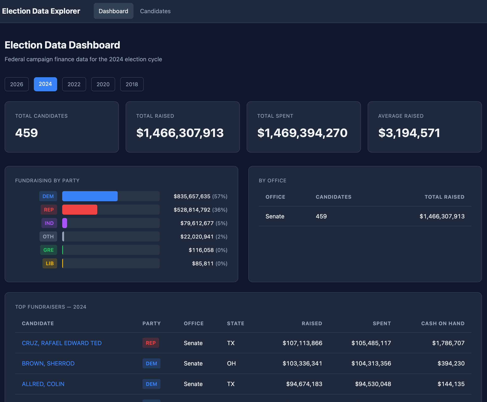

# Election Data Explorer

A Django web app that imports U.S. federal campaign finance data from the [FEC API](https://api.open.fec.gov/developers/) and lets you explore how much Senate candidates raised and spent in each election cycle.

**Live demo:** https://election-data-explorer.onrender.com/
*(Hosted on a free plan, so the first visit after a quiet spell can take about a minute to load.)*



## Features

- **Dashboard**: totals raised and spent per cycle, fundraising by party, breakdown by office, top fundraisers
- **Candidate explorer**: search by name; filter by party, office, state and cycle; sortable by money raised, spent or cash on hand
- **Candidate detail**: finances, burn rate, and a table of the candidate's fundraising across election cycles
- **Import command** for the FEC API: paginated, retries when the FEC is slow, safe to re-run, and keeps one row per candidate per cycle
- **Offline demo data** (`load_sample_data`, clearly fictional), Django admin, automated tests
- **Deployed** on Render with PostgreSQL on Neon (`build.sh`, gunicorn, WhiteNoise, `DATABASE_URL`)

## Tech stack

Python, Django 5.2, PostgreSQL (Neon in production, SQLite for local development), gunicorn, WhiteNoise, Requests, Render

## How it works

1. `import_candidates` calls the FEC's `/candidates/totals/` endpoint page by page and saves each candidate with `update_or_create`, so re-running it never creates duplicates.
2. Each row is one candidate in one election cycle, enforced by a unique constraint on (`candidate_id`, `election_year`). That lets the app compare the same candidate across cycles.
3. Pages read only from the database, using Django ORM queries and aggregation, so the site never waits on the FEC API.

## Quick start

```bash
python -m venv venv && source venv/bin/activate    # Windows: venv\Scripts\Activate.ps1
pip install -r requirements.txt
cp .env.example .env                               # Windows: copy .env.example .env
python manage.py migrate
python manage.py load_sample_data                  # fictional demo data
python manage.py runserver
```

Open http://127.0.0.1:8000/. For the full walkthrough (real FEC data, GitHub, deployment, troubleshooting) see **[SETUP_GUIDE.md](SETUP_GUIDE.md)**.

## Real data

Get a free key at https://api.open.fec.gov/developers/ and set `FEC_API_KEY` in `.env`, then:

```bash
python manage.py load_sample_data --clear
for y in 2018 2020 2022 2024 2026; do
  python manage.py import_candidates --cycle $y --office S --max-pages 10
done
```

Use `--office H` for House candidates or `--office P` for presidential candidates, and `--state VA` to limit to one state.

## Configuration

| Variable | Purpose |
|---|---|
| `SECRET_KEY` | Required when `DEBUG` is off (see `.env.example`) |
| `DEBUG` | `True` locally; leave unset in production |
| `DATABASE_URL` | PostgreSQL URL; SQLite is used when unset |
| `FEC_API_KEY` | FEC API key; falls back to the rate-limited `DEMO_KEY` |
| `ALLOWED_HOSTS` | Extra comma-separated hostnames |

## Deployment

The live site runs on a free Render web service with a free Neon PostgreSQL database.

- **Build command:** `bash build.sh` (installs packages, collects static files, runs migrations)
- **Start command:** `gunicorn config.wsgi:application --bind 0.0.0.0:$PORT`
- **Environment variables:** `SECRET_KEY`, `DATABASE_URL`, `FEC_API_KEY`, `PYTHON_VERSION`
- **Data:** loaded by running `import_candidates` locally with `DATABASE_URL` pointing at the production database

## Tests

```bash
python manage.py test elections
```

26 tests cover the models, views and import command. The FEC API is mocked, so the tests run offline.

## Roadmap

- Cycle filter on the candidates page
- Individual contributions (donors) per candidate
- REST API with Django REST Framework
- Docker and docker-compose with PostgreSQL
- Scheduled daily imports
